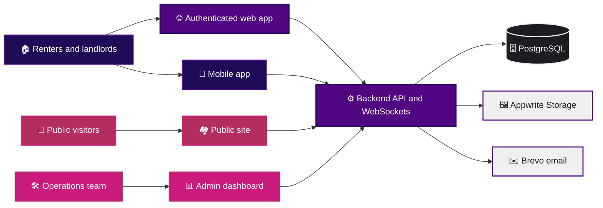

# AptPal

AptPal is a rental housing platform for renters and landlords. It includes authenticated web and mobile apps, a public portal for listings, an operations dashboard, and a shared backend.

## Projects

- [Backend](backend/README.md) — Django API, real-time services, and integrations.
- [Frontend](frontend/README.md) — authenticated web app for renters and landlords.
- [Site](site/README.md) — public portal and rental listings.
- [Admin](admin/README.md) — operations dashboard for moderation and platform management.
- [Mobile](mobile/README.md) — Android and iOS app built with Expo.

Each project README contains its setup instructions and commands.

## How the projects fit together

## Technology

- **Backend:** Python, Django REST Framework, PostgreSQL, Django Channels
- **Web apps:** React, TypeScript, Vite, Tailwind CSS
- **Mobile:** React Native, TypeScript, Expo SDK 58
- **File storage:** Appwrite Storage
- **Email:** Django's configured email backend with Brevo SMTP

## Shared design system

The web and mobile apps share AptPal's palette and light, dark, and system theme modes. Brand colors include `#1F0A57`, `#510782`, `#B32E5F`, and `#CB1A7D`.

## License

This project is licensed under the [PolyForm Noncommercial License 1.0.0](LICENSE). You may use, modify, and share it for noncommercial purposes only. Commercial use requires a separate license; contact [saiyeraneha24@gmail.com](mailto:saiyeraneha24@gmail.com) to request one.
